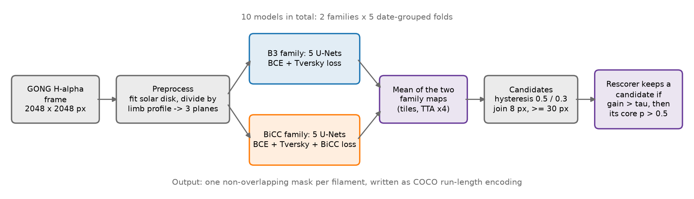
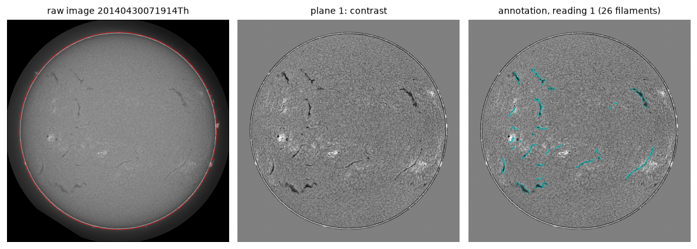
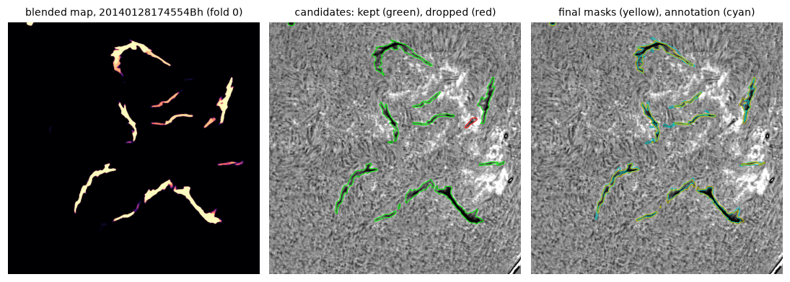
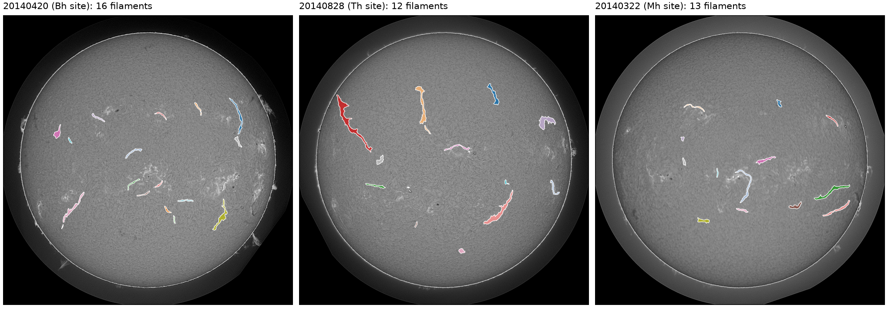

# Solar filament instance segmentation (Filament Segmentation Challenge 2026)

Our solution to the [Solar Filament Segmentation Challenge 2026](https://www.kaggle.com/competitions/filament-segmentation-2026)
(IEEE BigData Cup 2026). The task: find every filament in a GONG H-alpha full-disk image (2048 x 2048 px) and give one mask per filament.
The metric is panoptic quality (PQ); a prediction counts as correct when its IoU with an annotated filament is above 0.5.

**Authors:** Shyam Sunder Kumar, Ayushi Nema (A4I)

| Result | Value |
|---|---|
| Cross-validated PQ (5 date-grouped folds, 707 images, 1,154 annotator readings) | **0.4519** (95 % CI 0.4426 - 0.4611) |
| Public leaderboard PQ | **0.40** (Kaggle submission 56952453) |
| Submitted file | [`data/fsc26_final_submission.csv`](data/fsc26_final_submission.csv): 1,102 masks on 177 of the 180 test images |



## Reproduce the results, step by step

Everything runs from one notebook, [`notebooks/fsc26_pipeline.ipynb`](notebooks/fsc26_pipeline.ipynb).
The notebook only calls functions in `src/filament`; the method code is not hidden in the notebook.

| Step | What to do | Time |
|---|---|---|
| 1. Get the code | `git clone https://github.com/theainerd/filament_segmantation.git && cd filament_segmantation` | 1 min |
| 2. Create the environment (Python 3.12) | `python3.12 -m venv .venv && source .venv/bin/activate && pip install -r requirements.txt` | 5 - 10 min |
| 3. Get the competition data | Follow [`data/README.md`](data/README.md). The data go to `data/MAGFiLO_1.0_Kaggle_2026/`. | 5 min (0.7 GB) |
| 4. Check the install | `PYTHONPATH=src python -m pytest -q tests` (6 tests) | under 1 min |
| 5. Run the notebook | `jupyter nbconvert --to notebook --execute --inplace --ExecutePreprocessor.timeout=-1 notebooks/fsc26_pipeline.ipynb` (or open it in JupyterLab and run all cells) | about 1 h on a GPU |
| 6. Check the result | The last cell prints the mask IoU between your predictions and `data/fsc26_final_submission.csv`. The expected value is `min 1.0000`. | seconds |
| 7. Submit (optional) | Upload `data/output/submission.csv` to the Kaggle competition. | |

What the notebook does in step 5 (the default mode is `TRAIN = "release"`):

1. Downloads the 10 trained models and the blended out-of-fold maps from the GitHub release `v1.0` into `data/release/` (490 MB).
2. Rebuilds the 5 date-grouped folds and checks that they equal `data/splits.json`.
3. Extracts candidate filaments from the out-of-fold maps and refits the rescorer (about 3 min on a CPU).
4. Cross-validates the full pipeline: PQ 0.4519 (about 3 min on a CPU).
5. Predicts the 180 test images with the 10 models and writes `data/output/submission.csv`.
6. Compares the predictions with the submitted file.

Settings at the top of the notebook:

| Setting | Values |
|---|---|
| `TRAIN = "release"` | Use the released models. Fast; this reproduces the submitted file. |
| `TRAIN = "smoke"` | Run one very short training on the CPU to test the training code, then use the released models. |
| `TRAIN = "full"` | Train all 10 models from the training data (about 17 h on one NVIDIA A10). The result is close to the released models but not bit-identical (GPU arithmetic, library versions). |
| `N_TEST = None` | Predict all 180 test images. Set a small number (for example `1`) for a quick check; on a 6-core CPU one image takes about 20 min. |

To train one model on its own:

```bash
export PYTHONPATH=src MAGFILO_ROOT=data/MAGFiLO_1.0_Kaggle_2026
python -m filament.train --fold 0 --out runs/b3_f0   --encoder efficientnet-b3 --epochs 30 --steps 500 --bs 12 --lr 4e-4
python -m filament.train --fold 0 --out runs/bicc_f0 --encoder efficientnet-b3 --epochs 30 --steps 500 --bs 12 --lr 4e-4 --bicc-w 0.3
```

## Repository layout

```
data/        splits.json, the submitted predictions, and instructions for the competition data
notebooks/   fsc26_pipeline.ipynb: training, post-processing, cross-validation and inference in one notebook
src/filament the Python package used by the notebook (see the table below)
tests/       unit tests (PQ metric, RLE round trip, losses, post-processing, rescorer bookkeeping)
requirements.txt   exact package versions
```

| Module (`src/filament/`) | Purpose |
|---|---|
| `pipeline.py` | The steps the notebook calls: folds, training, blending, candidates, rescorer, cross-validation, inference |
| `data.py` | Reads the COCO annotations (one entry per annotator reading) and the images |
| `preprocess.py` | Fits the solar disk, removes limb darkening, builds the 3 input planes |
| `train.py`, `losses.py` | Model, tile sampler, training loop, losses (BCE + Tversky, BiCC) |
| `infer.py`, `predict.py` | Tiled inference with test-time augmentation; loads the fold models and averages them |
| `postprocess.py`, `rescoring.py` | Candidate extraction, rescorer features, exact PQ bookkeeping for candidate subsets |
| `metrics.py`, `rle.py` | The official PQ metric; run-length encoding and the submission file format |

## Method



1. **Preprocessing.** Fit a circle to the solar disk and divide the image by its radial brightness profile (limb darkening).
   The model receives 3 planes: this contrast plane, the intensity divided by the disk median, and the radius divided by the disk radius.
2. **Targets.** Each pixel target is the fraction of annotator readings that marked the pixel as filament (soft labels).
   The annotators disagree often: one annotator scored against another gets PQ 0.34.
3. **Models.** U-Net with an ImageNet-pretrained EfficientNet-B3 encoder and scSE decoder attention.
   Two families, each trained on 5 date-grouped folds (10 models):
   *B3* uses BCE + Tversky loss; *BiCC* adds a bidirectional connected-component loss (weight 0.3) that scores every annotated and every predicted component on the same scale.
   Training: 512 px crops (75 % around filament pixels), flips and rotations, intensity jitter, AdamW (learning rate 4e-4, one-cycle), batch 12, 30 epochs of 500 steps; the checkpoint with the best validation PQ is kept.
4. **Inference.** 512 px tiles with 128 px overlap and Hann-window blending, 4 rotations (test-time augmentation).
   Average the 5 folds of a family, then average the 2 families.
5. **Post-processing.** A permissive rule finds candidates (hysteresis thresholds 0.5 / 0.3, fragments closer than 8 px joined, at least 30 px).
   A gradient-boosted regressor (the rescorer, 16 shape and probability features) predicts each candidate's expected PQ gain and keeps the candidate if the gain is above a threshold tau (0.25, chosen on out-of-fold PQ).
   The final mask of each kept filament is its core: the pixels with probability above 0.5.



Held-out PQ of the single models (default rule post-processing, 4 rotations), as printed by the notebook:

| Fold | 0 | 1 | 2 | 3 | 4 |
|---|---|---|---|---|---|
| B3 | 0.4375 | 0.4328 | 0.4145 | 0.4153 | 0.4138 |
| B3 + BiCC | 0.4455 | 0.4380 | 0.4375 | 0.4288 | 0.4119 |

Cross-validated PQ of the full pipeline (blend of both families, rescorer refitted without the evaluated fold, core rule):

| Fold | 0 | 1 | 2 | 3 | 4 | All |
|---|---|---|---|---|---|---|
| PQ | 0.4585 | 0.4609 | 0.4536 | 0.4437 | 0.4429 | 0.4519 |

Pooled over all folds: SQ 0.6846, TP 5,092, FP 2,135, FN 3,107. The 95 % interval is a bootstrap over images.



*Predictions in the submitted file on three test frames (one colour per filament).*

## Notes on reproducibility

- **Environments.** `requirements.txt` pins the environment that ran the notebook (Python 3.12, PyTorch 2.13, scikit-learn 1.9.1).
  The 10 models were trained earlier on an NVIDIA A10 with Python 3.10, PyTorch 2.7, NumPy 1.26 and scikit-learn 1.5.2.
  The rescorer is refitted by the notebook (fixed random seed), so it uses the pinned scikit-learn.
- **Data rules.** We used only the competition training images and annotations. Inference uses only the H-alpha test images.
- **GPU.** Inference of the 10 models needs a GPU for practical run times; the code also runs on a CPU.

## Data, licence and acknowledgements

- Code: [MIT licence](LICENSE).
- The competition data (MAGFiLO) are licensed CC BY-NC 4.0 and are **not** redistributed here. The figures in this repository show small parts of these data for illustration.
- Dataset: A. Ahmadzadeh et al., *A dataset of manually annotated filaments from H-alpha observations*, Scientific Data 11, 1031 (2024), doi:10.1038/s41597-024-03876-y.
- This work uses GONG data obtained by the NSO Integrated Synoptic Program, managed by the National Solar Observatory, which is operated by AURA under a cooperative agreement with the National Science Foundation.
- BiCC loss: *BiCC: Bidirectional Connected-Component Loss for Instance-Aware Segmentation*, arXiv:2609.30223.
- Libraries: [segmentation_models_pytorch](https://github.com/qubvel-org/segmentation_models.pytorch), PyTorch, scikit-learn, pycocotools.
